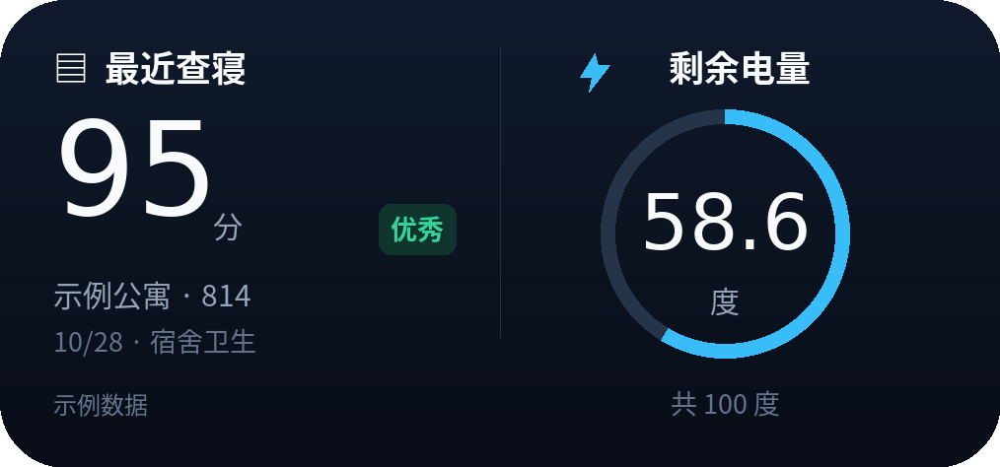
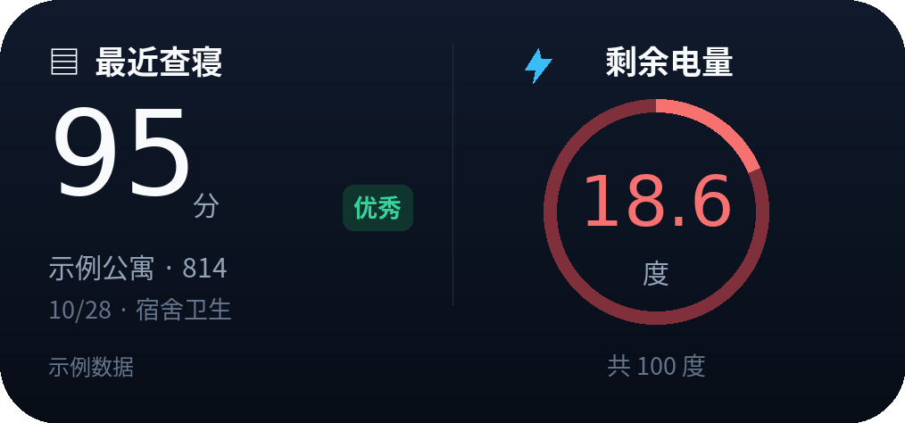

# 查寝 / 电量

适用于 iPhone Scriptable 的中号（4×2）查寝与电量组件。

 

*效果示意，均为示例数据。*

## 特征

- 左侧显示最近查寝成绩、等级和日期，右侧圆环显示剩余电量。
- 固定深色；低于 20 度时数字和圆环变红。
- 手动设置最大度数，显示「共 ×× 度」；缺失值显示「—」。
- 支持 HTTP / HTTPS、Keychain 保存配置及离线缓存；建议每 30 分钟刷新，实际由 iOS 调度。

## 用法

1. 下载 [DormElectricity.js](https://github.com/liuayueeryuan0313/2/releases/latest/download/DormElectricity.js)，导入 Scriptable。
2. 部署支持专用接口的 [sdut-dorm-monitor](https://github.com/liuayueeryuan0313/sdut-dorm-monitor)，在「连接与计划 → 小组件接口」生成 Token。
3. 运行脚本 →「配置接口与 Token」，填服务地址和完整 `dw_` Token。可填 `http://IP:端口` 或完整 `/api/widget/v1/dorm` 地址；手机需能访问服务。
4. 选「设置圆环最大电量」填大于 0 的度数，再向桌面添加 Scriptable 中号组件并选择此脚本。

读取不会触发学校采集。更新版本时替换脚本即可，已保存配置会保留。
